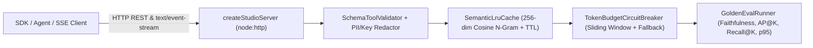

# fullstack-rag-eval-studio

[](LICENSE)
[](package.json)
[](src/index.d.ts)
[](package.json)

Zero-dependency **TypeScript / Node.js 22 ESM AI SDK & Streaming Evaluation Gateway** uniting strict JSON-Schema tool-call validation, deterministic PII/secret scrubbing, cosine n-gram semantic LRU caching, sliding-window token/cost circuit breakers, and RAG evaluation over REST + Server-Sent Events (`SSE`).

---

## RFC System Architecture



---

## Empirical Golden-Suite Benchmarks (`npm run bench`)

| Metric / Subsystem | Measured Value | Specification |
| :--- | ---: | :--- |
| **Golden Evaluation Cases** | **`120`** | Multi-domain RAG & adversarial distractor suite |
| **Faithfulness** | **`1.0000` (`100.0%`)** | Claim-level lexical entailment against retrieved chunks |
| **Context Precision (`AP@2`)** | **`0.9750` (`97.5%`)** | Rank-weighted precision across top-$K$ chunks |
| **Recall@2** | **`1.0000` (`100.0%`)** | Relevant document coverage in top-$K$ retrieval |
| **Semantic LRU Cache Hit Rate** | **`96.7%`** | Exact + `256`-dim L2 cosine n-gram similarity (`>= 0.82`) |
| **End-to-End $p_{50}$ / $p_{95}$ Case Latency** | **`0.0944 ms` / `0.3362 ms`** | Validator + Cache + Breaker + RAG Evaluator per case |
| **Evaluation Throughput** | **`7,623.5 cases/s`** | Zero external runtime dependencies (`Node v22.23.5`) |

---

## Quickstart

### 1. Run Unit, Ephemeral HTTP & Live SSE Streaming Tests
```bash
npm test
npm run bench
```

### 2. SDK & Streaming Gateway Usage
```ts
import {
  SchemaToolValidator,
  SemanticLruCache,
  TokenBudgetCircuitBreaker,
  GoldenEvalRunner,
  createStudioServer,
} from "fullstack-rag-eval-studio";

const studio = createStudioServer({ topK: 5 });
const { url } = await studio.listen(8095, "127.0.0.1");
// GET  ${url}/health
// POST ${url}/v1/evaluate
// GET  ${url}/v1/stream?query=hybrid+rag+bm25+rrf
```

### 3. Containerized Deployment
```bash
docker build -t fullstack-rag-eval-studio:1.0.0 .
docker run --rm -p 8095:8095 fullstack-rag-eval-studio:1.0.0
```

---

## License

Released under the [MIT License](LICENSE). Copyright (c) 2026 Nahian Akhtar.
