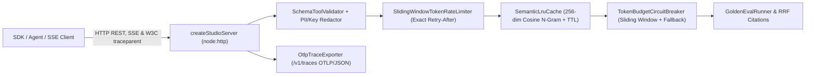

# fullstack-rag-eval-studio

[](LICENSE)
[](package.json)
[](src/index.d.ts)
[](package.json)

Zero-dependency **TypeScript / Node.js 22 ESM AI SDK & Streaming Evaluation Gateway (`v1.2.0`)** uniting strict JSON-Schema tool-call validation, rule-based PII/secret scrubbing, cosine n-gram semantic LRU caching, per-client token-budget sliding-window rate limiting (`SlidingWindowTokenRateLimiter`), OpenTelemetry (`OTLP/JSON`) trace span & latency histogram export (`OtlpTraceExporter` + W3C `traceparent`), pairwise A/B prompt & chunking regression diffing (`RegressionDiffAnalyzer` + CLI), and RAG evaluation over REST + Server-Sent Events (`SSE`).

---

## RFC System Architecture



---

## Empirical Golden-Suite Benchmarks (`npm run bench`)

| Metric / Subsystem | Measured Value | Specification |
| :--- | ---: | :--- |
| **Golden Evaluation Cases** | **`120`** | Multi-domain RAG & adversarial distractor suite (`12/12` `node:test` suites) |
| **Faithfulness** | **`1.0000` (`100.0%`)** | Claim-level lexical entailment against retrieved chunks |
| **Context Precision (`AP@2`)** | **`0.9750` (`97.5%`)** | Rank-weighted precision across top-$K$ chunks |
| **Recall@2** | **`1.0000` (`100.0%`)** | Relevant document coverage in top-$K$ retrieval |
| **Semantic LRU Cache Hit Rate** | **`96.67%`** | Exact + `256`-dim L2 cosine n-gram similarity (`>= 0.82`) |
| **Full-Pipeline $p_{50}$ / $p_{95}$ Case Latency** | **`0.1246 ms` / `0.4468 ms`** | Validator + RateLimiter + Cache + Breaker + OTLP Span + Evaluator |
| **Evaluation Throughput** | **`5,456.0 cases/s`** | Zero external runtime dependencies (`Node v22.23.5`) |

---

## Quickstart

### 1. Run Unit, Ephemeral HTTP/SSE & OTLP Tracing Tests
```bash
npm test
npm run bench
```

### 2. SDK, Rate-Limited RAG Query & Streaming Gateway Usage (`v1.2.0`)
```ts
import {
  SchemaToolValidator,
  SemanticLruCache,
  SlidingWindowTokenRateLimiter,
  OtlpTraceExporter,
  TokenBudgetCircuitBreaker,
  GoldenEvalRunner,
  RegressionDiffAnalyzer,
  createStudioServer,
} from "fullstack-rag-eval-studio";

const studio = createStudioServer({
  topK: 5,
  rateLimiterOptions: { windowMs: 60_000, maxRequestsPerWindow: 60, maxTokensPerWindow: 12_000 },
});
const { url } = await studio.listen(8095, "127.0.0.1");
// GET  ${url}/health
// POST ${url}/v1/query     (RRF citations + X-RateLimit-* + W3C traceparent)
// GET  ${url}/v1/stream?query=hybrid+rag+bm25+rrf
// GET  ${url}/v1/traces    (OpenTelemetry OTLP/JSON resourceSpans & histograms)
// POST ${url}/v1/evaluate
// POST ${url}/v1/diff
```

### 3. Pairwise A/B Prompt & Chunking Regression Diff + OTLP CLI (`v1.2.0`)
```bash
npx fullstack-rag-eval-studio diff baseline.json candidate.json --format markdown --otlp-out diff.otlp.json
npx fullstack-rag-eval-studio eval suite.json --top-k 5 --otlp-out eval.otlp.json
```

### 4. Containerized Deployment
```bash
docker build -t fullstack-rag-eval-studio:1.2.0 .
docker run --rm -p 8095:8095 fullstack-rag-eval-studio:1.2.0
```

---

## License

Released under the [MIT License](LICENSE). Copyright (c) 2026 Nahian Akhtar.
